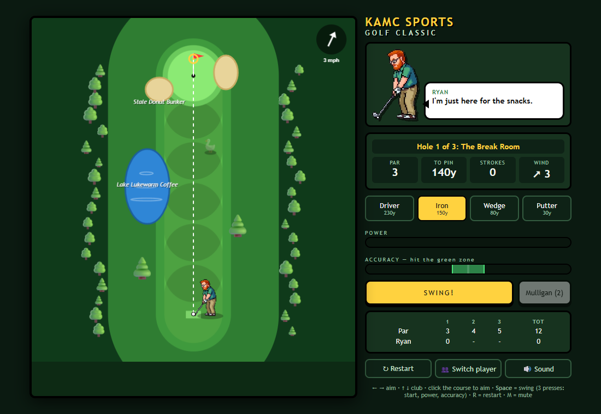

# KAMC Sports Golf Classic

A tiny three-hole office golf game that runs in the browser. Pick a golfer, play through
**The Break Room**, **Conference Call Creek** and **The Never-Ending Meeting**, dodge the goose,
and put your initials on the leaderboard.



No build step, no dependencies, no server: it is a single `index.html` plus sprite images.

## Running it

Open `index.html` in any modern browser (Chrome, Edge, Firefox, Safari). That's it.

If you prefer serving it over HTTP:

```bash
python -m http.server 8000
# then open http://localhost:8000
```

## How to play

1. **Pick a golfer** on the title screen (click a card, or press `1`, `2` or `3`).
2. **Aim** with `←` `→` or by clicking on the course. The dashed line shows the club's range.
3. **Choose a club** with `↑` `↓` or by clicking it. A sensible club is pre-selected for you.
4. **Swing** with three presses of `Space` (or the SWING! button):
   1. start the power meter,
   2. lock the power,
   3. stop the accuracy needle inside the green zone.
5. Get the ball in the hole in as few strokes as you can. Lowest total over three holes wins.

### Controls

| Input | Action |
| --- | --- |
| `←` / `→` | Aim |
| `↑` / `↓` | Change club |
| Click on the course | Aim at that spot |
| `Space` | Swing (3 presses: start, power, accuracy) |
| `R` | Restart the round (asks first) |
| `M` | Mute / unmute |
| `Esc` | Dismiss a confirmation prompt |
| `1` `2` `3` | Pick a golfer on the title screen |

The panel buttons offer **Mulligan**, **Restart**, **Switch player** and **Sound** too.
The power and accuracy meters speed up on each later hole.

## Golfers

| Golfer | Style | Power | Sweet spot | Perk |
| --- | --- | --- | --- | --- |
| **Ron** "Old Reliable" | Short but steady | 0.92x | Very wide | none |
| **David** "Big Dog" | Long and wild | 1.12x | Narrow | none |
| **Ryan** "Lucky Charm" | Perfectly average | 1.00x | Medium | 22% chance a ball that finds water or a tree gets a lucky bounce back to safety |

## Rules as implemented

The game follows real stroke-play golf, with a few clearly labelled house rules for fun.

**Scoring**

- Every swing is one stroke. Lowest total strokes wins. Total par is 12 (3 + 4 + 5).
- **Water hazard:** the ball is lost, you take a **1 stroke penalty** and replay from where you just hit
  (stroke and distance).
- **Out of bounds** (into the bushes, 50 yards off the centerline): same as water, **+1 penalty** and replay.
- **Maximum score:** a hole is never scored higher than **8 strokes**. Reach it and the ball is picked up.
  Penalties can't push a hole past 8.

**Lies and hazards**

- **Rough** costs 18% of your distance, **bunkers** 40% (putter: 50%). Fairway and green are clean.
- **Trees:** a ball that lands in a tree drops at its base on the side it came from. No penalty.
- **Putts roll on the ground.** A putt that rolls into water, a tree, a bunker or out of bounds stops
  there. A ball that starts in a bunker can putt out of it.
- Full shots fly over hazards and only count where they **land**.
- **Wind** pushes full shots (not putts). The arrow shows where it blows, the number is its strength.
- **The goose:** a full shot that lands within 8 yards of the goose gets kicked 16 to 28 yards away,
  and the goose waddles off (never into water or out of bounds).

**Holing out**

- A ball that comes to rest within **1.6 yards** of the pin drops in (chip-ins and hole-in-ones count).
- Within **3.2 yards** it is a conceded tap-in: it counts, and costs **one extra stroke**.
  If you have no strokes left, you pick up instead.

**House rules (not real golf)**

- **Mulligans:** 2 per round. A mulligan takes back your last shot, penalty strokes included.
  The count resets when a round restarts.
- **Ryan's lucky bounce** (see Golfers).

## High scores

Finish a round and, if your total makes the **top 10**, you're asked for your **3 initials** (letters A-Z).
The leaderboard shows rank, initials, golfer, strokes and score to par. It also appears on the title screen.

- Lowest strokes ranks first. Ties go to whoever posted first, and a score has to beat the
  10th place to get on a full board.
- **Skip** if you don't want to post a score. Your last initials are pre-filled next time.
- Scores are saved in your browser's `localStorage` (key `kamcGolfScores`), so they stay on this
  browser and device. Clearing site data erases them. "Clear high scores" on the title screen wipes them too.
- If storage is blocked (some private-browsing modes), the game still works and tells you the score
  won't be remembered.

## Restart and switch player

- **Restart** (button or `R`) puts the same golfer back on hole 1 with a fresh scorecard and 2 mulligans.
- **Switch player** returns to golfer select. The round in progress is abandoned and not saved.
- Both ask for confirmation once there's progress to lose, and the game **pauses** while the prompt is
  open. After a finished round, **Play again** and **Switch player** are on the results screen.

## Customizing

Everything lives in [index.html](index.html), near the top of the `<script>`:

- `CHARS`: golfers, their stats (`power`, `zone`, `luck`) and all their one-liners.
- `HOLES`: the courses. Each hole has a centerline `path`, a `green`, and `water`, `sand`, `trees` and a `goose`.
  Distances are in yards, `x` is right and `y` is toward the pin. Par, scorecard and
  the leaderboard adjust automatically.
- `MAX_STROKES`, `TAP_IN`, `GIMME`, `MAX_SCORES`, `CLUBS`, `BOUND`: the rule constants.

If you change the number of holes or the course, clear the high scores (or change `SCORE_KEY`), since
rounds on different courses aren't comparable.

## Project layout

```
index.html           the whole game (HTML, CSS, JS)
assets/sprites/      per-pose golfer sprites (idle, aim, swing, finish, win)
assets/*.webp        golfer portrait source art
assets/screenshot.png
tools/slice_sprites.py   dev-only script that cuts character sheets into sprites (not needed to play)
```

## License

MIT. See [LICENSE](LICENSE).
